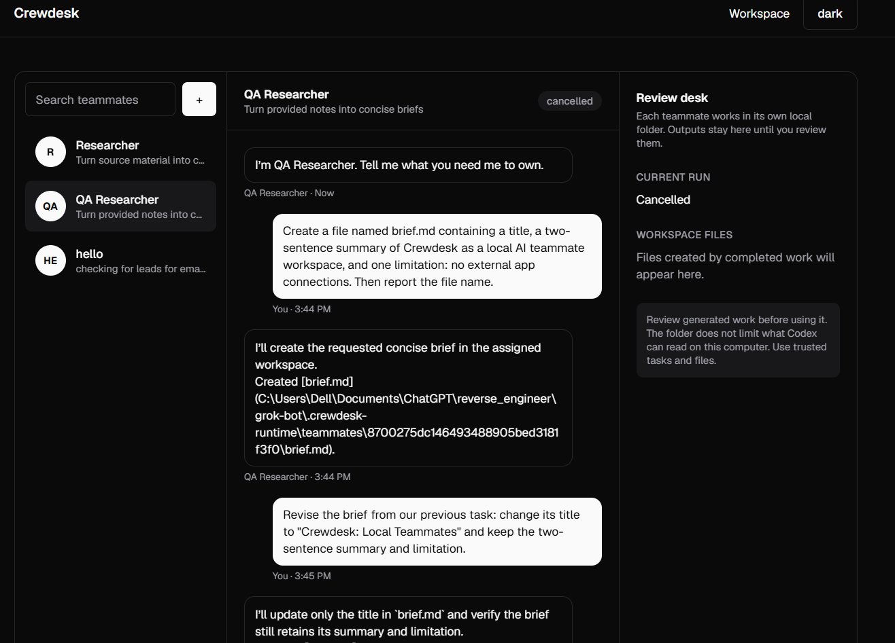

# Brockbot

**Eat. Sleep. Delegate. Conquer. Repeat.**

Brockbot is a local workspace for assigning focused tasks to named AI teammates. It uses the Codex CLI installed and signed in on your computer. You can watch a run, inspect its files, and continue the conversation with the same teammate.

[](https://tenor.com/view/brock-lesnar-brock-screaming-scream-wwe-gif-15264992645832530187)



## Run it

Requirements: Node.js 20 or later and a locally installed, signed-in Codex CLI (`@openai/codex`). The current runner expects the npm installation at `%APPDATA%\npm\node_modules\@openai\codex\bin\codex.js` on Windows.

```powershell
npm install
npm run dev
```

Open <http://127.0.0.1:3000/workspace>. The server binds to the local machine. For a production build, run `npm run build` and `npm start`.

## What it does

- Create teammates with a name, role, and standing instructions.
- Send tasks and attach supported source files.
- Watch run progress, cancel a run, and inspect or download generated files.
- Continue a teammate conversation after reviewing its output.
- Keep teammate files in an ignored `.brockbot-runtime/` folder.

## Current limits

Brockbot is a single-user local app. It has no cloud computer, background runs after the server stops, schedules, app connectors, or team sharing. The teammate folder organizes files; it is **not** a security boundary on what the Codex process can read on your computer. Use trusted tasks and review outputs before using them. Codex CLI may send prompts and file contents to its configured model service under your Codex account settings.

This is an independent, Grok Bot inspired project and is not affiliated with xAI. The preview image shows an earlier UI name and an example local file path.
